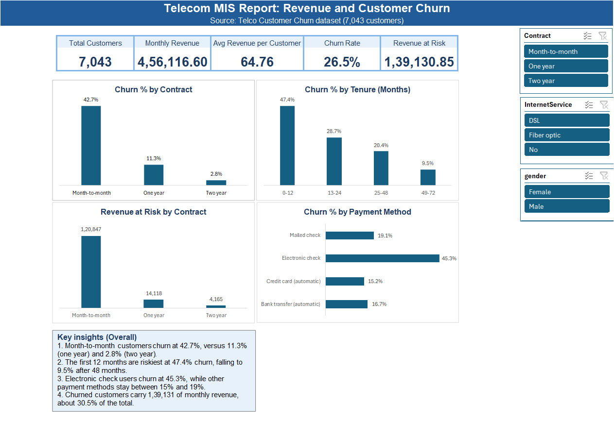

# Telco MIS Report

Excel MIS report on 7,043 telecom customers: consolidated department data with XLOOKUP, built Pivot Tables, slicers and a KPI dashboard for revenue and churn analysis.

## Dashboard

## Objective

Collect data from separate department sheets, clean and consolidate it into one master report, and prepare a management-ready dashboard showing customer, revenue and churn metrics.

## Dataset

[Telco Customer Churn (Kaggle)](https://www.kaggle.com/datasets/blastchar/telco-customer-churn): 7,043 customers and 21 columns.

To simulate departmental data, the single CSV was split into three sheets: Customer, Service and Billing. Each sheet keeps `customerID` as the common key.

## Workflow

1. **Collect:** Split the dataset into Customer_Info, Service_Info and Billing_Info sheets.
2. **Clean:** Converted text-formatted `TotalCharges` to numbers and handled 11 blank values (new customers with 0 tenure) using `IFERROR`, `VALUE` and `TRIM`. Checked for duplicates (none found).
3. **Consolidate:** Joined the three sheets into one consolidated data sheet using `XLOOKUP` on `customerID`. Added helper columns: `TenureBand`, `RevenueAtRisk` and `ChurnFlag`.
4. **Analyse:** Built 11 Pivot Tables across Customer, Revenue and Churn report sheets.
5. **Report:** Created an interactive dashboard with KPI cards, four charts and three slicers (Contract, Internet Service, Gender). KPIs are linked to slicers using `GETPIVOTDATA`.

## KPIs

| KPI | Value |
|---|---|
| Total customers | 7,043 |
| Monthly revenue | 4,56,116.60 |
| Average revenue per customer | 64.76 |
| Churn rate | 26.5% |
| Revenue at risk (churned customers) | 1,39,130.85 |

## Key insights

- Month-to-month customers churn at **42.7%**, compared with 11.3% for one-year and 2.8% for two-year contracts.
- The first 12 months are the riskiest (**47.4%** churn), falling to 9.5% after 48 months.
- Electronic check users churn at **45.3%**, while other payment methods stay between 15% and 19%.
- Churned customers account for about **30.5%** of total monthly revenue.

## Tools and skills used

MS Excel: Pivot Tables, Slicers, PivotCharts, XLOOKUP, GETPIVOTDATA, IFERROR, Data Validation, Conditional Formatting, Data Cleaning, Dashboard Design

## Files

- `Telco_MIS_Report.xlsx`: complete workbook (raw data, department sheets, consolidated data, reports, dashboard)
- `Dashboard.png`: dashboard preview

## Author

Shweta Kumari | [LinkedIn](https://linkedin.com/in/shwetakumariofficial) | [GitHub](https://github.com/ShwetaKumari16)
